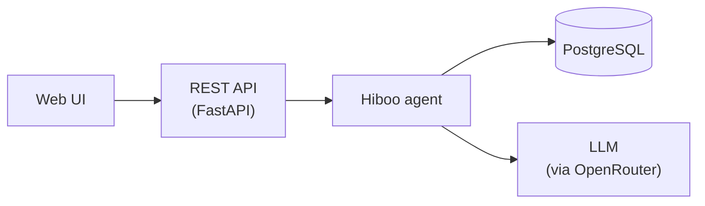

# Architecture

Hiboo is a Python application built around a single agent. This document grows with the code: each component is added here when it is implemented.

## Current state

The project is at its starting point:

- Python 3.12 package with a `src/` layout, managed with [uv](adr/0001-use-uv-for-project-management.md)
- Code quality with ruff, tests with pytest

## Planned for v1.0

A user pastes a job offer. The offer is turned into structured data, compared with the user's profile, scored, and stored with the application. Details will be documented as each step is built.

## Principles

- **No scraping.** Job offers are pasted or imported by the user.
- **Open source first** for libraries, databases and models.
- **Personal data stays out of the repository.**

## Decisions

Significant technical choices are documented as [Architecture Decision Records](adr/).
